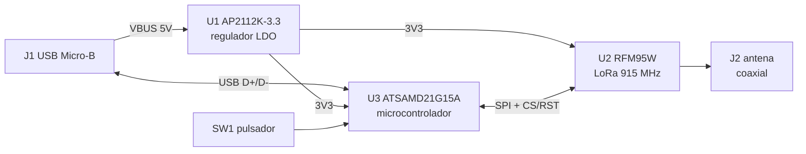
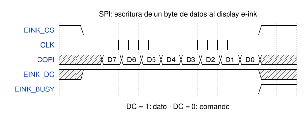
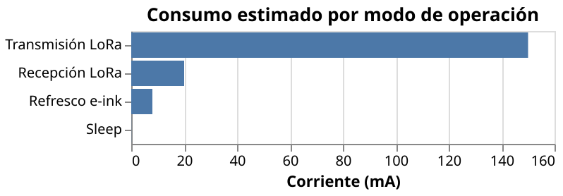

# DemoGit: nodo LoRa con display e-ink

> TODO: describe en una frase qué es esta placa y para qué sirve.

 

## Descripción

TODO: 2-3 frases. ¿Qué problema resuelve? ¿Dónde se usaría?

## Diagrama de bloques

GitHub dibuja este diagrama automáticamente (es [Mermaid](https://mermaid.js.org/)).



## Componentes principales

| Ref. | Componente | Función |
|------|-----------|---------|
| U1 | AP2112K-3.3 | Regulador lineal 3.3 V |
| U2 | RFM95W-915S2 | Radio LoRa 915 MHz |
| U3 | ATSAMD21G15A-A | Microcontrolador ARM Cortex-M0+ |
| J1 | USB Micro-B | Alimentación y datos |
| J2 | Conector coaxial | Antena |
| TODO | TODO: display e-ink | TODO |

## Cálculos de diseño

La resistencia de pull-up del reset (R2) consume, con el botón presionado,
$I = \frac{V_{CC}}{R_2} = \frac{3.3\,V}{10\,k\Omega} = 0.33\,mA$.

Potencia disipada en el regulador LDO (U1) durante la transmisión LoRa:

$$
P_{LDO} = (V_{in} - V_{out}) \cdot I = (5\,V - 3.3\,V) \cdot 150\,mA \approx 0.26\,W
$$

Autonomía estimada con una batería de 1000 mAh y un consumo promedio de 2 mA:

$$
t = \frac{C_{bat}}{I_{prom}} = \frac{1000\,mAh}{2\,mA} = 500\,h \approx 21\ \text{días}
$$

## Interfaz SPI del display



Fuente editable: [`docs/spi-eink.json5`](docs/spi-eink.json5) ([WaveDrom](https://wavedrom.com/))

## Consumo de energía



Fuente editable: [`docs/consumo.vl.json`](docs/consumo.vl.json) ([Vega-Lite](https://vega.github.io/vega-lite/)). Valores ilustrativos.

## Estructura del repositorio

```
DemoGit/
├── DemoGit.kicad_pro      # proyecto KiCad
├── DemoGit.kicad_sch      # esquemático
├── DemoGit.kicad_pcb      # layout
├── sym-lib-table          # librerías de símbolos del proyecto
├── Library/               # símbolos propios (E_Ink_Display)
├── docs/                  # diagramas: fuentes (.json5, .json) y SVG exportados
└── README.md              # este archivo
```

## Cómo abrir el proyecto

1. Instala [KiCad 10](https://www.kicad.org/download/).
2. Clona el repositorio:
   ```bash
   git clone https://github.com/TODO-tu-usuario/demogit.git
   ```
3. Abre `DemoGit.kicad_pro` con KiCad.

## Historial de versiones

Ver la pestaña [Releases](../../releases) del repositorio. Cada release incluye el PDF del esquemático.

| Versión | Fecha | Cambios |
|---------|-------|---------|
| v0.1.0 | TODO | Primer release: esquemático base + display e-ink |

## Autor

- TODO: tu nombre ([@tu-usuario](https://github.com/TODO))
